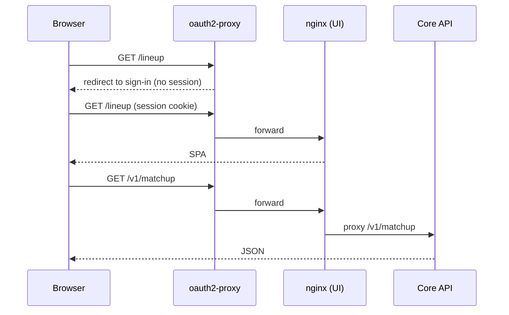

`oauth2-proxy` sits in front of both the UI and `/v1/*` on one origin. The UI has no login screen of its own.

## What happens when a session expires?

If any API call returns `401`, the client redirects to `/oauth2/sign_in?rd=<current path>`, so sign-in returns you to the same page. If the redirect doesn't navigate within 1.5 seconds, a red "Session expired — redirecting to sign-in…" banner appears.

The failed request never settles. This avoids flashing an error in the instant before the page unloads.

## How are write endpoints protected?

nginx adds the `X-API-Key` header to the write endpoints below, using the server-side `TRIGGER_API_KEY` variable. The browser never sees the key.

| Route | Used by |
|---|---|
| `POST /v1/trigger/waiver` | Waivers, Move overview |
| `POST /v1/trigger/lineup` | Lineup |
| `POST /v1/trigger/draft-pick` | Draft Day |
| `POST /v1/trade/incoming/<id>/triage` | Inbox |
| `POST /v1/trade/incoming/<id>/decision` | Inbox |
| `POST /v1/trade/incoming/<id>/decision/retry` | Inbox |
| `POST /v1/trade/incoming/<id>/counter` | Inbox |

If the API rejects the key with `401`, nginx returns `502` with a message telling you to contact an administrator, instead of a `401` that would trigger a sign-in redirect.

:::warning
Never put `TRIGGER_API_KEY` in a `VITE_*` variable or browser storage. `VITE_*` values are bundled into the page.
:::

## What isn't authenticated?

The **approver label** on trade approvals is a self-reported name for the audit trail. It is not a verified identity.
