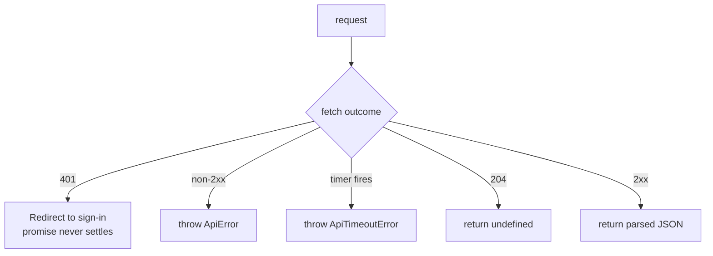

All calls go through `request()` in `src/api/client.ts`. It sends JSON, parses JSON, and throws on failure.

## What does request() do?

| Behavior | Detail |
|---|---|
| Timeout | 15 s by default. The timer covers reading the body too. Slow calls pass a longer one: 45 s for league rows and practice-room teardown, 90 s for `move-preview`. |
| `401` | Redirects to `/oauth2/sign_in` and never settles. See [Authentication](../auth.md). |
| Non-2xx | Throws `ApiError(status, message)`. The message comes from `detail` or `message` in the body, with FastAPI validation errors flattened. |
| `204` | Returns `undefined`. |
| Abort | Throws `ApiTimeoutError` when the timer fired, otherwise rethrows. |

## Where do the endpoints live?

| File | Holds |
|---|---|
| `src/api/client.ts` | Draft, roster, matchup, waiver, trade, chat and stats calls |
| `src/api/dashboard.ts` | Activity, league rows and move preview |
| `src/api/tradeInbox.ts`, `tradeApproval.ts`, `tradeResponseRetry.ts` | Inbox and approval flows |
| `src/api/weekReads.ts` | Shared query definitions for week-scoped reads |

## Where do the types come from?

`src/api/types.ts`, `tradeInboxTypes.ts`, `tradeScoreTypes.ts` and `tradeContextTypes.ts` are hand-written. Each notes the `fantasy-core-pipeline` model it mirrors. Update them in the same change as the API.

:::info
Writes return `202` when the queue accepts a message. Types model that as an accepted or duplicate receipt with a tracking ID, never as a confirmed ESPN outcome.
:::

## How do I add an endpoint?

1. Add the response type to the matching `types` file.
2. Add a function that calls `request<T>()`.
3. If the browser sends a write to `/v1/trigger/*` or `/v1/trade/incoming/*`, check the nginx and Vite proxy rules attach the API key. See [Authentication](../auth.md).
4. Add a query definition or mutation in the page that uses it.
