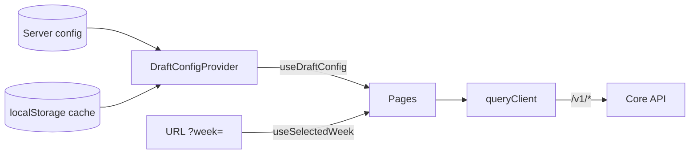

Server data lives in TanStack Query. Small UI state stays in component state.

## How is league config stored?

`useDraftConfig()` returns `{ config, loading, saveConfig }`. The server copy (`/v1/draft/config`) is authoritative; `localStorage` under `fantasy-web-ui.draft-config` is a cache so a reload renders instantly. Pages avoid flashing "not configured" by waiting for `loading` to clear.

## How does caching work?

| Setting | Value |
|---|---|
| `staleTime` | 2 minutes |
| `gcTime` | 15 minutes |
| Retries | Up to 2, never on `4xx` |
| Refetch on focus | Yes |
| Mutation retries | None |

Week-scoped reads share keys across pages, so Lineup, Matchup and Waivers reuse each other's data. Changing league, team or season calls `setQueryScope`, which clears the cache. `invalidateRoster()` refetches roster-related reads after a write.

## How is the week chosen?

`useSelectedWeek()` returns the `?week=1..18` value when valid, otherwise the live league week from `/v1/league/current-week`. Never default a page to week 1 or a build-time week.

## Which pages poll?

| Page | Interval |
|---|---|
| Waivers | 60 s |
| League standings | 60 s |
| Draft Day | Server-sent events from `/v1/draft/stream` |
