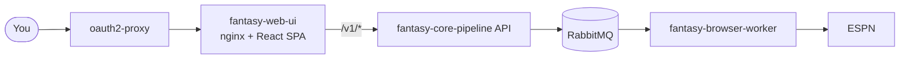

The web UI is a single-page console for managing your fantasy team: lineup, matchup, waivers, trades, league standings and bot activity. It talks only to the `fantasy-core-pipeline` API.

## Where do I start?

| I want to… | Read |
|---|---|
| Use the UI | [User guide](./user-guide/index.md) |
| Run it locally or change the code | [Developer guide](./developer/index.md) |
| Understand how sign-in works | [Authentication](./auth.md) |
| Match colors and layout conventions | [Design system](./design-system.md) |
