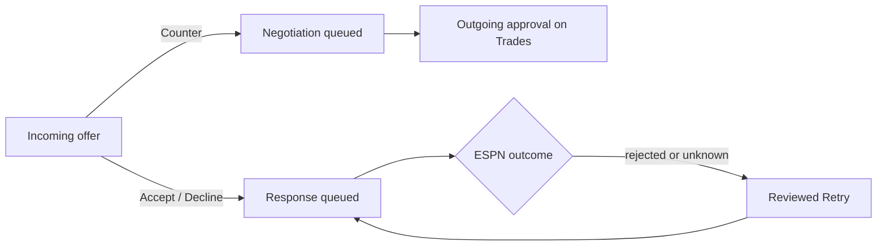

Route: `/inbox`. Incoming offers appear in the API's rank order, with score evidence, expiry and negotiation history.

## What does it show?

- Each offer's players, notes, score breakdown and expiry. Unavailable breakdowns say so explicitly.
- For an offer that answers or follows your counter, the thread: every offer in order, whose move it is, and how many of the thread's counters you have used.

## Which endpoints does it call?

| Endpoint | Purpose |
|---|---|
| `GET /v1/trade/incoming` | Ranked incoming offers |
| `GET /v1/trade/incoming/<id>/thread` | Negotiation history |
| `POST /v1/trade/incoming/<id>/triage` | Mark seen, snooze or dismiss |
| `POST /v1/trade/incoming/<id>/decision` | Accept or decline |
| `POST /v1/trade/incoming/<id>/decision/retry` | Retry a rejected or unknown response |
| `POST /v1/trade/incoming/<id>/counter` | Queue a counter |
| `GET /v1/league/current-week`, `GET /v1/league/teams` | Context |

## What actions can it take?

| Action | Confirmation | Effect |
|---|---|---|
| Seen, Snooze, Dismiss | Approver label (snooze also needs a future time) | Changes the offer's triage state |
| Accept, Decline | Dialog showing exact players and notes, a verification checkbox and approver label | Queues the response |
| Counter | Same dialog | Queues negotiation for later outgoing approval; no ESPN counter is sent yet |
| Retry | Reviewed dialog; unknown outcomes also need confirmation that ESPN shows the offer unanswered | Re-queues the response |

Counter is disabled once the thread reaches its counter limit.

:::info
A queue receipt is separate from a confirmed ESPN outcome. Follow the **Activity** link in the receipt to check.
:::
