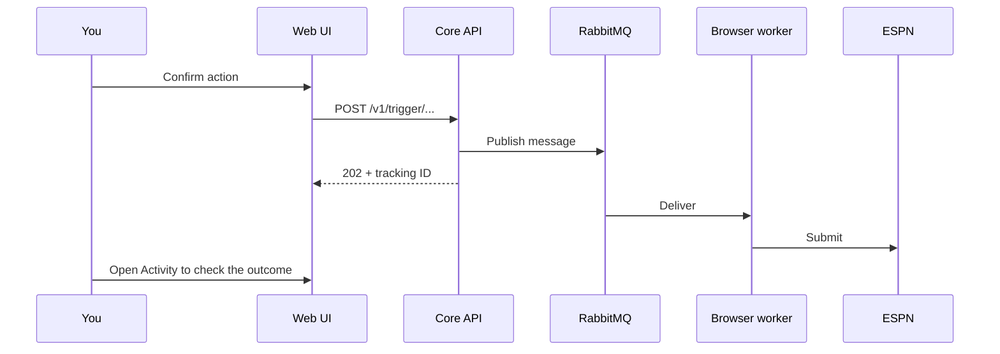

Each page below has the same layout: what it shows, the core endpoints it calls, and its actions. Actions that write to ESPN always show a confirmation first.

:::tip[The short version]
Set your league and team in [Settings](./settings.md) first. Every other page asks for them. Writes are queued, not instant: a queued receipt means the worker accepted the request, not that ESPN changed.
:::

## Which page do I need?

| Group | Page | Use it to… |
|---|---|---|
| Your team | [Lineup](./lineup.md) | Swap starters and bench, move players to or from IR |
| | [Matchup](./matchup.md) | Compare your starters with this week's opponent |
| | [Waivers](./waivers.md) | See ranked pickups and open a move review |
| | [Trades](./trades.md) | Evaluate a trade and approve outgoing proposals |
| | [Inbox](./inbox.md) | Triage and answer incoming trade offers |
| League | [Scoreboard](./scoreboard.md) | See every matchup's score for a week |
| | [Standings & leaders](./league.md) | See standings and player leaders |
| Activity | [Submissions & sessions](./activity.md) | Track queued actions and LLM sessions |
| | [Assistant](./chat.md) | Ask questions about your league |
| Draft | [Draft Day](./draft-day.md) | Follow a live draft and intervene |
| | [Practice Draft](./draft-day.md#practice-draft) | Rehearse against a mock draft room |
| Tools | [Analytics](./analytics.md) | Browse VORP and backtest results |
| | [Settings](./settings.md) | Set league, team and season |
| (linked from Waivers and Trades) | [Move overview](./move-overview.md) | Review a waiver or trade before sending it |

## How do queued actions work?

A `202` receipt only means the queue accepted the message. Use [Activity](./activity.md) with the tracking ID to see what ESPN did.

## What do the week controls do?

Weekly pages follow the current league week unless the URL has `?week=1..18`. The week selector sets that parameter, and **Current week** removes it. Lineup submissions are allowed only for the current week; other weeks are planning views.
