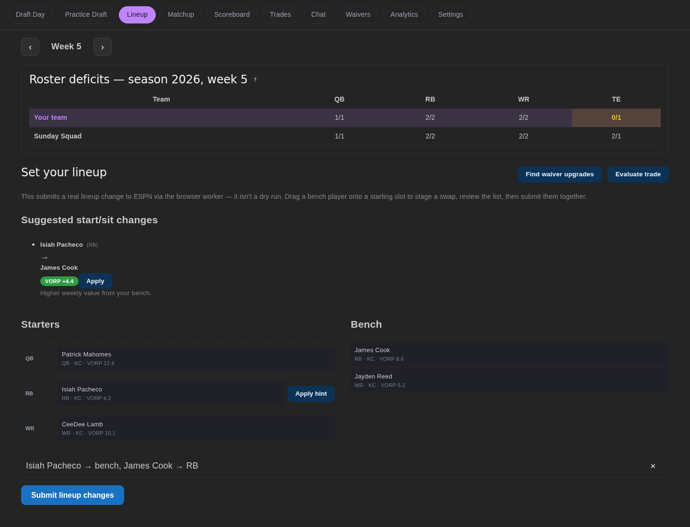
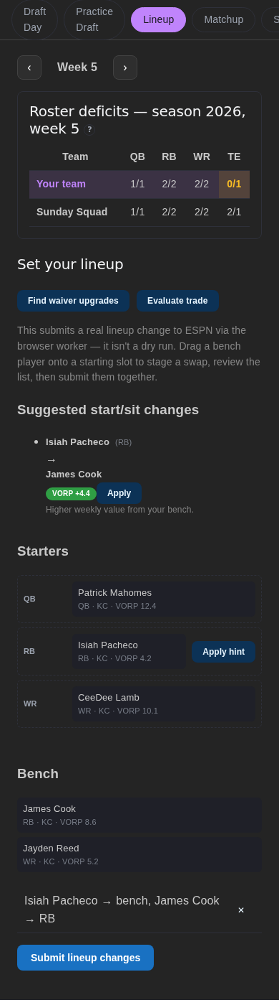

Route: `/lineup` (the default page). It shows your roster by slot, the league's position depth, and the swap and IR controls.

## What does it show?

- A week selector and, when you have an opponent, a **View matchup** link.
- A position-depth grid comparing your team with the league.
- Your starters and bench, with injury badges and suggested bench swaps.
- Bench and IR as separate sections. Each shows how many of the league's slots are filled (for example "Bench 6/7", "IR 1/1"), with a placeholder for every open spot. An open bench spot links to **Browse free agents** on [Waivers](./waivers.md). Counts appear only once the league's settings have synced.

Only a bench player can be dragged onto a starting slot. IR players have to be activated first.

## Which endpoints does it call?

| Endpoint | Purpose |
|---|---|
| `GET /v1/matchup/roster` | Roster for the selected week (works on a bye) |
| `GET /v1/roster/deficits` | Position depth grid |
| `GET /v1/matchup` | Opponent banner; a `404` is treated as "no opponent" |
| `GET /v1/league/current-week` | Default week |
| `POST /v1/trigger/lineup` | Submit swaps or IR moves |

## What actions can it take?

| Action | Confirmation | Effect |
|---|---|---|
| Stage a swap | None | Held in the page until you submit |
| **Submit lineup changes** | Button only | Queues the staged swaps for the worker |
| IR move or activation | **Confirm** dialog | Queues a live ESPN IR change |
| **Track lineup changes** | None | Opens the submission in [Activity](./activity.md) |

:::warning
Submit is enabled only for the current week; other weeks are planning only. A queued receipt does not confirm ESPN changed. ESPN can still refuse an IR move, so check your roster afterward.
:::

Staged swaps survive a trip to Waivers or Trades and back. On narrow screens the quick actions wrap:

