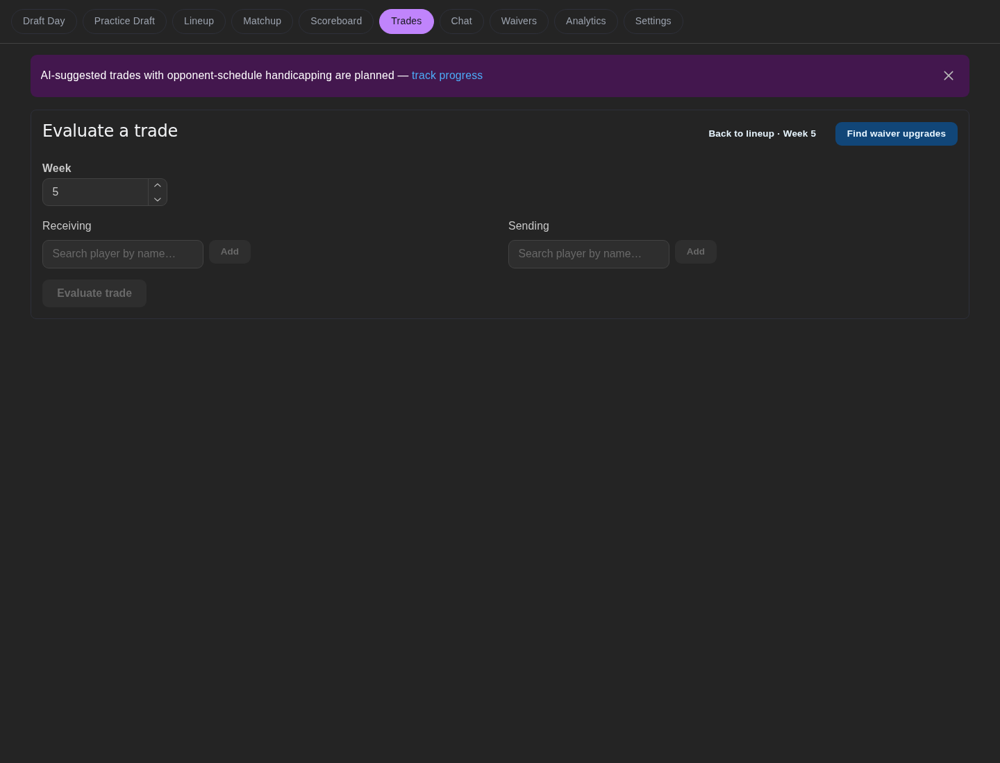

Route: `/trades`. Three stacked panels.

## What does it show?

| Panel | Shows |
|---|---|
| Outgoing trade proposals | Proposals awaiting your approval: counterparty, players sent and received, pitch, score evidence. Each trade scan (Wednesday and Friday) can stage up to three alternatives, one per team, best first. |
| League trade context | Team needs, schedule, each player's NFL bye and the counterparty's bye-crunch weeks, and provenance, for a chosen horizon and counterparty |
| Evaluate a trade | Manual VORP comparison for players you pick |

## Reading the score and strength

Proposals show **Our lineup gain**, **Schedule boost** and **Cost of helping them** as separate signed values. Their lineup gain contributes a penalty to our score, weighted fully in head-to-head weeks and lightly otherwise. Teal values are above +0.05, pink values below −0.05, and values inside that dead band use secondary text. Unavailable data stays unavailable. Open **Score breakdown** for the returned score terms and weekly evidence.

The round **?** buttons explain the numbers on hover, keyboard focus or tap. Press Escape or tap again to dismiss an explanation.

Strength compares completed fantasy points per week with the league average and displays two decimals. The displayed value determines the label: at least +0.50 is **strong**, at most −0.50 is **weak**, and other observed values are **average**. Orange means above +0.05, blue means below −0.05, and values inside that dead band use secondary text. Missing strength uses a dashed **unknown** chip. Strength is neither win probability nor NFL defense difficulty.

## Which endpoints does it call?

| Endpoint | Purpose |
|---|---|
| `GET /v1/trade/offers` | Outgoing proposals |
| `POST /v1/trade/offers/<key>/approve` | Approve a proposal |
| `GET /v1/trade/context` | League trade context |
| `POST /v1/trade/score` | Score and reasons for a proposal |
| `POST /v1/trade/evaluate` | Manual evaluator |
| `GET /v1/league/teams` | Team names |
| `GET /v1/players/search` | Player picker |

## What actions can it take?

| Action | Confirmation | Effect |
|---|---|---|
| Evaluate | None | Read-only comparison |
| **Review approval** | Dialog with exact players, approver label and checkbox | Queues the offer; the worker may propose a real trade to that manager in ESPN |
| **Refresh status** | None | Re-reads proposal status |

:::warning
Approval is not an ESPN confirmation. If the outcome is unknown, don't approve again until you refresh status.
:::
