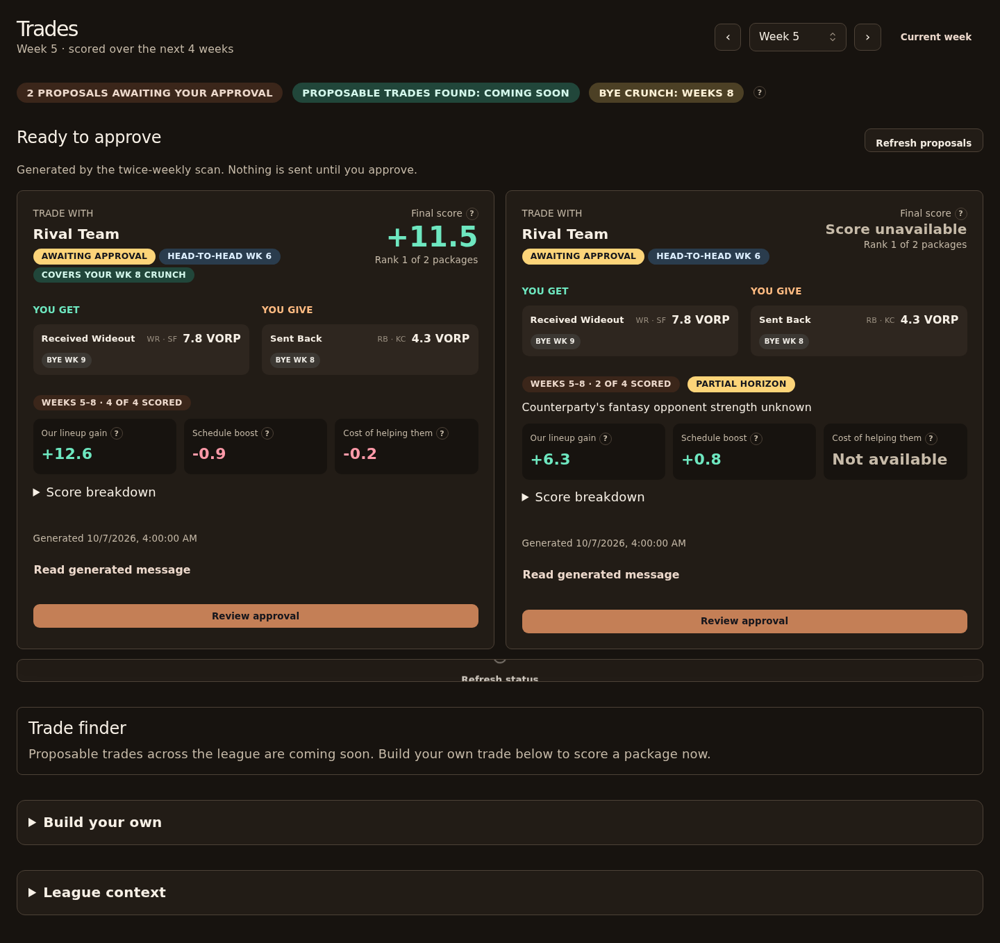

Route: `/trades`. Start with proposals that need approval, then discover or build a trade.

## What does it show?

| Panel | Shows |
|---|---|
| Ready to approve | Proposals awaiting your approval: counterparty, players sent and received, pitch, score evidence. Each trade scan (Wednesday and Friday) can stage up to three alternatives, one per team, best first. |
| League context (collapsed) | Team needs, schedule, each player's NFL bye and the counterparty's bye-crunch weeks, and provenance, for a chosen horizon and counterparty |
| Build your own (collapsed) | Pick players, choose a trading team and horizon, score the trade live, or compare single-week VORP |
| Trade finder | A placeholder for upcoming league-wide trade discovery |

The header summarizes proposals awaiting approval and upcoming bye-crunch weeks. The finder count remains a “coming soon” placeholder. **Look for a trade** in a bye-crunch banner opens `/trades#finder`.

Proposal cards show **You get** and **You give**, with position, VORP and NFL bye when those players can be matched to the current league roster. Unmatched players retain their names or ESPN IDs. A notification's `?offer=` link highlights its proposal.

## Review the outgoing message

Messages start collapsed. Open **Read generated message**, then **Edit message** to change the outgoing text. **Save message** accepts nonblank text up to 1000 characters; **Cancel** discards your unsaved changes. A saved local edit shows **Edited by you**, and **Reset to generated draft** restores the original before approval. Edited text is sent exactly as written and is not checked against the score. The generated draft stays with the offer.

The review dialog displays the final message, players and live score when a supported score request is available. Legacy proposals explicitly state when live scoring is unavailable. Check the acknowledgment, enter an approver name, then select **Approve and queue offer**. Queueing fixes the offer's terms; its returned offer key follows the edited message. If an already-saved edit returns for a retry after publication failure, its message is read-only because it cannot be edited a second time.

## Reading the score and strength

Proposals show **Our lineup gain**, **Schedule boost** and **Cost of helping them** as separate signed values. Their lineup gain contributes a penalty to our score, weighted fully in head-to-head weeks and lightly otherwise. Based on the rounded displayed value, teal values are above +0.05, pink values below −0.05, and values inside that dead band use secondary text. Unavailable data stays unavailable. Open **Score breakdown** for the returned score terms and weekly evidence. Card scores are stored evidence from generation; reviewing a supported proposal requests a fresh live score.

The round **?** buttons explain the numbers on hover, keyboard focus or tap. Press Escape or tap again to dismiss an explanation.

Strength compares completed fantasy points per week with the league average and displays two decimals. The displayed value determines the label: at least +0.50 is **strong**, at most −0.50 is **weak**, and other observed values are **average**. Based on the rounded displayed value, orange means above +0.05, blue means below −0.05, and values inside that dead band use secondary text. Missing strength uses a dashed **unknown** chip. Strength is neither win probability nor NFL defense difficulty.

In **Build your own**, a scored result shows a verdict and four tiles: our lineup gain, schedule boost, their lineup change and the cost of helping them. The weekly table puts the opponent strength, players entering and leaving each starting lineup, multiplier and weighted gain together. Unscored weeks retain their reasons. Changing the inputs hides the old result until you score again. **Propose this trade (coming soon)** is disabled; scoring your own package does not send a trade.

## Which endpoints does it call?

| Endpoint | Purpose |
|---|---|
| `GET /v1/trade/offers` | Outgoing proposals |
| `POST /v1/trade/offers/<key>/approve` | Approve a proposal |
| `GET /v1/roster/bye-outlook` | Upcoming bye-crunch summary |
| `GET /v1/trade/context` | League context (collapsed) |
| `POST /v1/trade/score` | Score and reasons for a proposal |
| `POST /v1/trade/evaluate` | Manual evaluator |
| `GET /v1/league/teams` | Team names |
| `GET /v1/players/search` | Player picker |

## What actions can it take?

| Action | Confirmation | Effect |
|---|---|---|
| Evaluate | None | Read-only comparison |
| **Review approval** | Dialog with exact players, score, final message, approver name and checkbox | Queues the offer; the worker may propose a real trade to that manager in ESPN |
| **Refresh status** | None | Re-reads proposal status |

:::warning
Approval is not an ESPN confirmation. If the outcome is unknown, don't approve again until you refresh status.
:::
