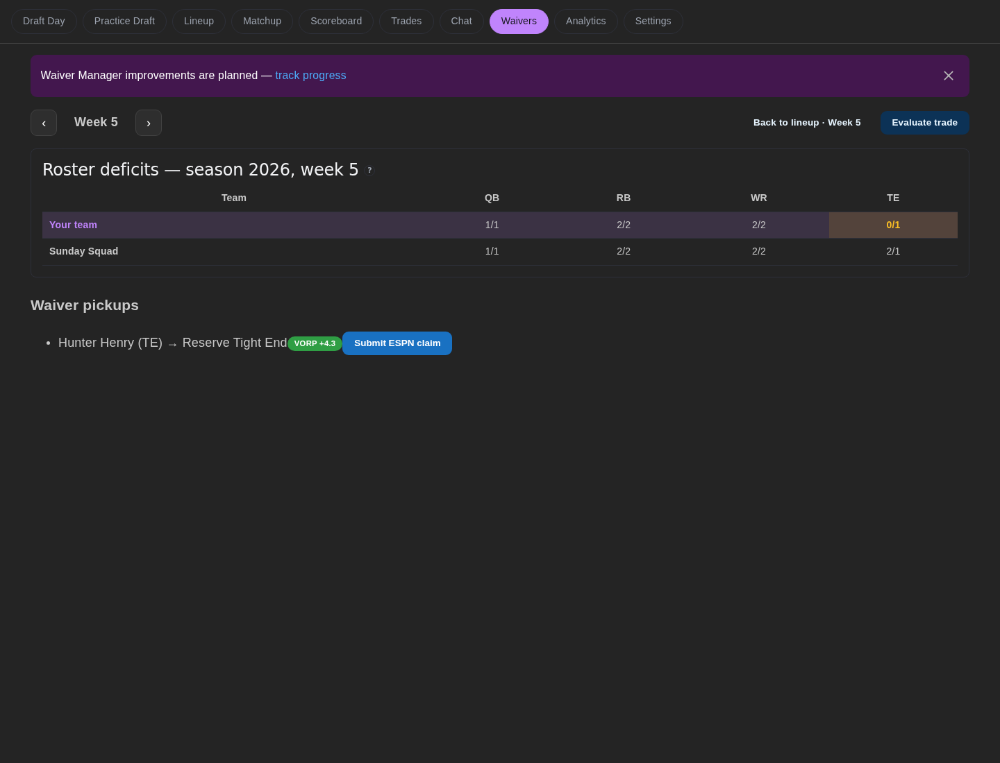

Route: `/waivers`. Recommendations refresh every 60 seconds.

## What does it show?

- Ranked add/drop recommendations with a **value over replacement (VORP)** badge. VORP is a per-week average over the next few weeks, with a bye week counted as replacement level, so a player on bye this week is never recommended as the drop. Each card also shows how your starting lineup changes, week by week, and each player's bye week.
- **Bye fill-ins**, marked **Covers Wk N bye**, for weeks where NFL byes leave your lineup short. You may see up to three alternatives for the same week, best first. A fill-in can be a below-replacement player, because any healthy starter beats an empty slot. They are suggestions only; the automatic waiver job never claims them. A fill-in never drops a player worth more than the one it adds.
- **Add-only pickups** when your roster has open non-IR slots. These show only the player to add, list first, and the page shows how many open roster slots you have.
- Open IR slots and IR moves, including dependency stages for IR-chained claims.
- A collapsible **Browse free agents** table of every claimable free agent: search by name, filter by position, sort by VORP or projection and page through results. Each row shows injury status, projected points, VORP and the suggested bench drop at that position with the VORP change if swapped. When projections for the selected week are not available yet, the table notes that it is using prior-week averages.
- A collapsible **League position depth** grid.

## Which endpoints does it call?

| Endpoint | Purpose |
|---|---|
| `GET /v1/waiver/recommendations` | Ranked recommendations, open roster and IR slots, IR moves |
| `GET /v1/waiver/free-agents` | Browse free agents (fetched only when the table is opened) |
| `GET /v1/roster/deficits` | Position depth grid |

## What actions can it take?

| Action | Confirmation | Effect |
|---|---|---|
| **Review move** | Opens [Move overview](./move-overview.md) | No write yet |
| **Add to open slot** (Browse free agents, only with an open roster slot) | Opens Move overview with no drop | No write yet |
| **Claim with drop** (Browse free agents) | Opens Move overview with the suggested drop selected; change it there | No write yet |
| Quick links | None | Jump to Lineup or Trades with the same week |

The claim itself is submitted from Move overview, behind a confirmation dialog with a dry-run option.
